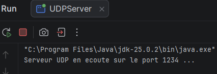
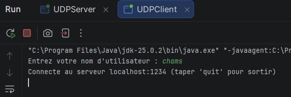
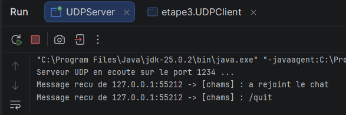
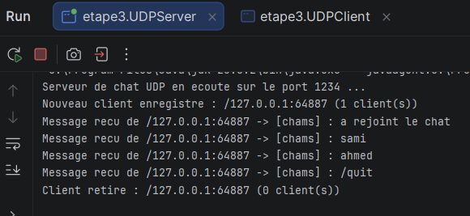
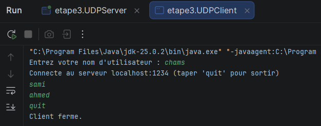

# TP 4 : Sockets en mode non-connecté UDP, service de chat client/serveur

**Étudiant :** [Nom Prénom] · **Groupe :** LSI 3 · **Matière :** Développement d'applications réparties

## Objectif
Maîtriser l'échange de datagrammes (`DatagramPacket`) avec les sockets UDP (`DatagramSocket`) en Java, et réaliser un service de chat client/serveur asynchrone, d'abord avec un seul client, puis avec plusieurs clients et diffusion des messages.

## Environnement
- JDK [version] · IDE : [IntelliJ IDEA / Eclipse / VS Code] · Git

## Structure du projet
```
TP4_UDP_Chat
├── README.md
├── captures/
└── src
    ├── etape2
    │   ├── UDPServer.java   Serveur : affiche chaque message avec l'IP et le port de l'expéditeur
    │   └── UDPClient.java   Client : envoie "[Nom] : message" au serveur
    └── etape3
        ├── UDPServer.java   Serveur : liste des clients + diffusion aux autres clients
        └── UDPClient.java   Client : un thread pour recevoir, un thread pour envoyer
```

## Exécution
Dans l'IDE : lancer `UDPServer`, puis une ou plusieurs instances de `UDPClient` (dans IntelliJ, activer *Allow multiple instances* dans la configuration d'exécution du client).

En ligne de commande, depuis la racine du projet :
```bash
javac -d out src/etape2/*.java src/etape3/*.java

# Étape 2
java -cp out etape2.UDPServer      # terminal 1
java -cp out etape2.UDPClient      # terminal 2

# Étape 3
java -cp out etape3.UDPServer      # terminal 1
java -cp out etape3.UDPClient      # terminal 2, 3, 4 ...
```
Le client accepte en argument l'adresse IP du serveur (par défaut `localhost`) : `java -cp out etape3.UDPClient 192.168.1.10`. On quitte un client en tapant `quit`.

## Étape 2 : Chat unidirectionnel avec un seul client

**Serveur** : un `DatagramSocket` lié au port **1234** avec `new InetSocketAddress(1234)`. Il boucle sur `socket.receive(packet)` (appel bloquant) et affiche l'adresse IP, le port de l'expéditeur et le contenu du message.

**Client** : il demande un nom d'utilisateur, puis lit les lignes saisies au clavier et les envoie au serveur dans un `DatagramPacket` sous la forme `[NomUtilisateur] : message`.

### Captures d'écran
**Serveur démarré**



**Client envoyant des messages**



**Le serveur affiche les messages reçus (adresse de l'expéditeur + contenu)**



## Étape 3 : Chat bidirectionnel avec diffusion à plusieurs clients

**Serveur** : il garde une liste d'adresses (`List<SocketAddress>`) des clients qui lui ont écrit, ce qui simule une « connexion ». À chaque message reçu :
1. il enregistre l'expéditeur s'il n'est pas déjà dans la liste ;
2. il retransmet le message à **tous les autres** clients enregistrés, sauf l'expéditeur.

Quand un client tape `quit`, il envoie un message de départ : le serveur le retire de la liste et prévient les autres.

**Client** : deux threads fonctionnent en parallèle. Un thread dédié reçoit les messages diffusés par le serveur et les affiche, pendant que le thread principal lit le clavier et envoie. À son démarrage, le client envoie un premier message « a rejoint le chat » : c'est ce qui permet au serveur de l'enregistrer, même s'il n'a encore rien écrit.

### Captures d'écran
**Serveur avec plusieurs clients enregistrés**



**Plusieurs clients échangeant des messages en temps réel**



## Synthèse
- **UDP** est un protocole **non connecté** : il n'y a ni établissement de connexion, ni garantie de livraison, d'ordre ou d'absence de doublons. En contrepartie, il est léger et rapide, ce qui convient bien à un chat simple.
- Une donnée est envoyée dans un **datagramme** (`DatagramPacket` : tableau d'octets, adresse et port du destinataire) par un `DatagramSocket`. Contrairement à TCP, il n'y a pas de `ServerSocket` ni de `accept()` : le serveur lit tous les datagrammes sur le même socket.
- Comme il n'y a pas de connexion, le serveur ne connaît un client que lorsqu'il reçoit un datagramme de sa part : il retrouve son adresse avec `packet.getSocketAddress()`. C'est pourquoi le client envoie un message « a rejoint le chat » au démarrage.
- `socket.receive()` est **bloquant**. Côté client, il faut donc deux threads : sans cela, le client ne pourrait pas attendre un message du serveur tout en lisant le clavier.
- Limites de cette réalisation : un message plus grand que le tampon (4096 octets) est tronqué, des datagrammes peuvent être perdus (ce qui est rare en local, mais possible sur un réseau), et un client qui s'arrête sans taper `quit` reste dans la liste du serveur, car UDP ne signale pas la déconnexion.

## Difficultés rencontrées
[À compléter avec vos observations.]
